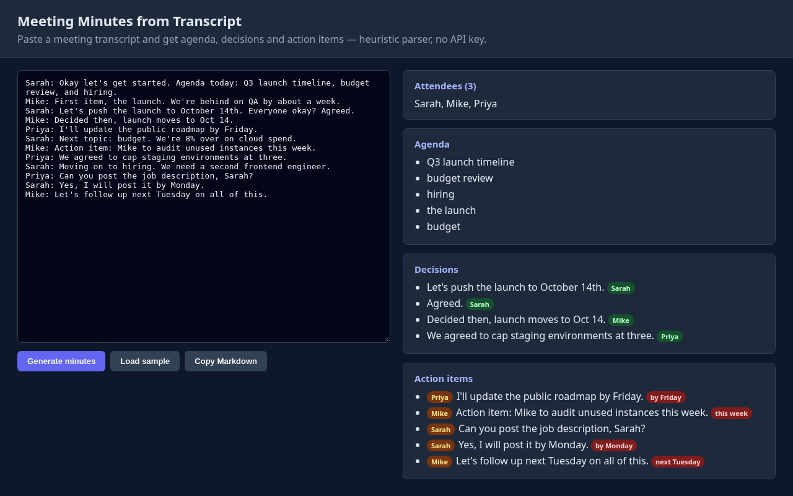

# Meeting Minutes from Transcript

Paste a meeting transcript and get agenda, decisions and action items — heuristic parser, no API key.



## Features
- Detects speakers/attendees from `Name:` prefixes
- Extracts agenda topics, decisions and action items (owner + due date) via keyword heuristics
- One-click copy as Markdown

## Dependencies
- **Node.js 16+** (only to serve the static files; the app itself is plain HTML/JS)
- **No npm runtime dependencies**, no API keys, no network calls — everything runs client-side.

## Run
```bash
git clone https://github.com/YardPhantom/meeting-minutes-from-transcript.git
cd meeting-minutes-from-transcript
npm start            # or: node server.js 8080
# open http://localhost:8080   (add ?demo=1 to auto-load the sample)
```
You can also just open `public/index.html` directly in a browser.

## License
MIT © Trevor Heshka

---
Built by [Trevor Heshka](https://trevorheshka.com)
